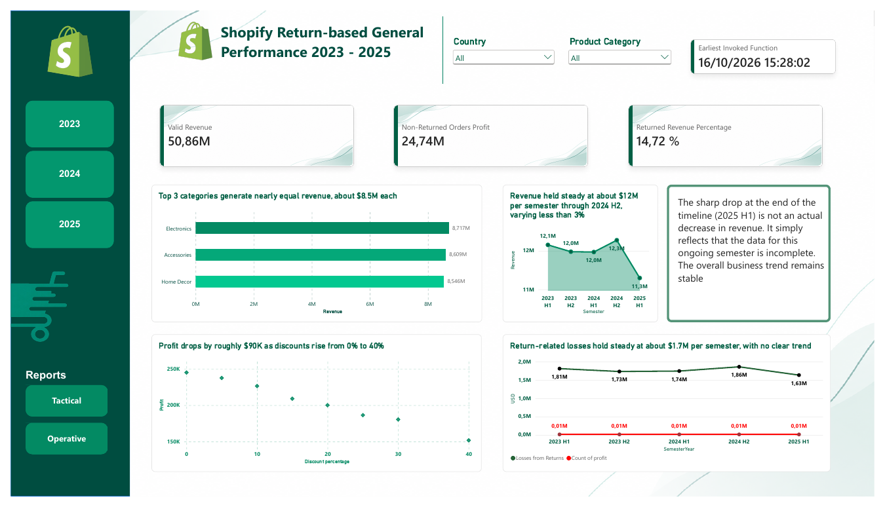
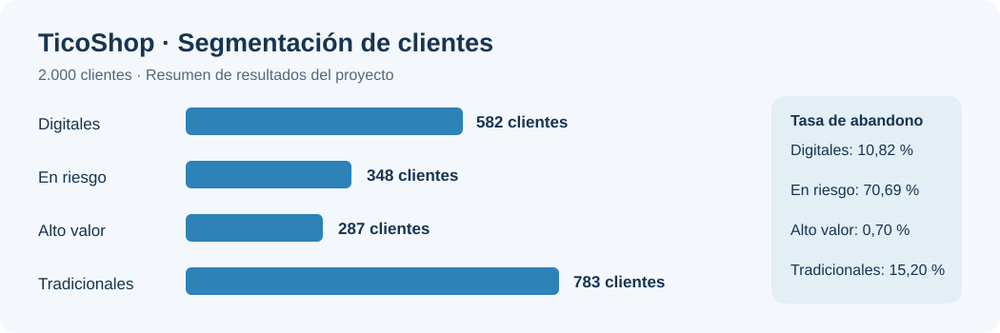
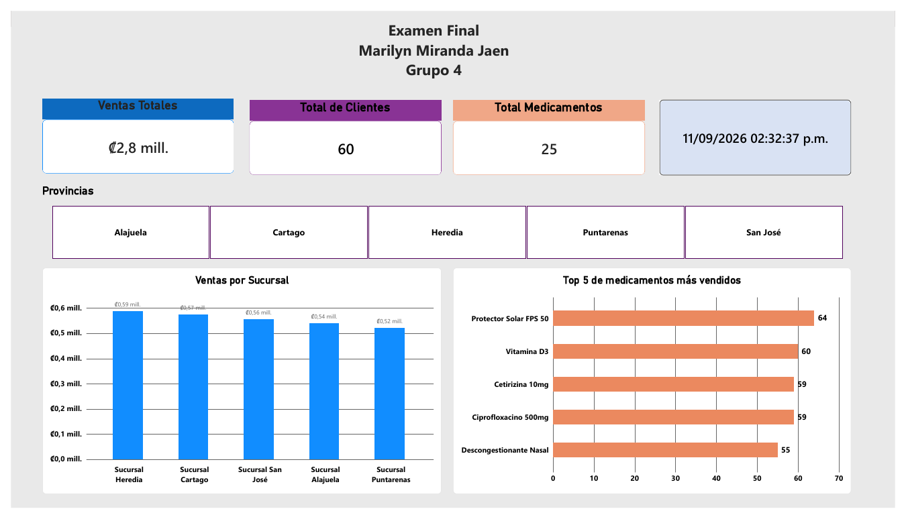
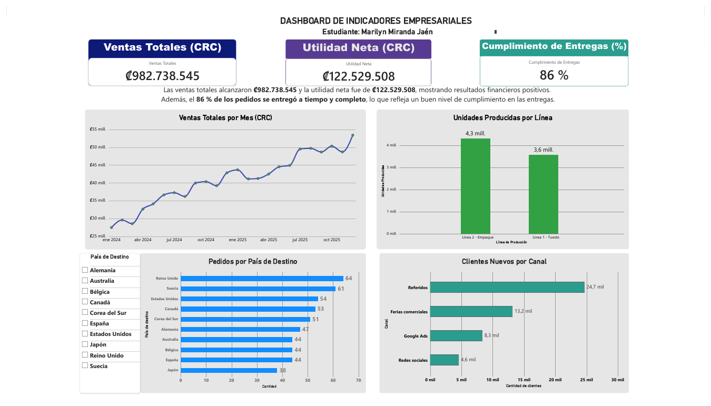

# 📊 Portafolio de Análisis de Datos

**Marilyn Miranda Jaén** · Ingeniera Informática · Costa Rica  
**Data Analyst | Python | SQL Server | Power BI | DAX | Excel**

*Transformando datos en información útil para la toma de decisiones.*

## 👩‍💻 Sobre mí

Soy ingeniera informática con más de cinco años de experiencia en Quality Assurance (QA), análisis y soporte de sistemas. 
Actualmente desarrollo proyectos de **análisis de datos, inteligencia de negocios y ciencia de datos**, aplicando limpieza, transformación, exploración, visualización y modelos analíticos para resolver problemas empresariales.

**Herramientas:** `Python` · `Pandas` · `SQL Server` · `Power BI` · `DAX` · `Power Query` · `Excel` · `Matplotlib` · `Scikit-learn` · `GitHub`

## 🌟 Proyectos destacados

### 1. 🛒 Shopify — Análisis de devoluciones en e-commerce

📂 **[Ver archivos del proyecto](https://github.com/MarilynMirandaJaen/Ciencia-de-Datos/tree/main/Unidad%206/Proyecto%20final)**

**Tecnologías:** Python, Pandas, Power BI, DAX, EDA, limpieza y transformación de datos.

**Reto:** comprender los patrones de devoluciones de una operación de comercio electrónico y su impacto sobre los ingresos y la rentabilidad.

**Qué hice:**
- Analicé un conjunto de **60.000 transacciones** y preparé los datos para su explotación analítica.
- Exploré ingresos, descuentos, categorías, países, motivos de devolución y costos asociados.
- Integré información de pedidos y devoluciones; elaboré **Golden Records** de clientes y productos.
- Desarrollé un dashboard con indicadores financieros, tácticos y operativos.

**Resultados observados en el dashboard:** **50,86 M** en ingresos válidos, **24,74 M** de utilidad en pedidos no devueltos y **14,72 %** de ingresos asociados a devoluciones (en las unidades monetarias mostradas por el reporte).

> **Aprendizaje:** cómo conectar calidad de datos, análisis exploratorio e indicadores de negocio para estudiar un problema real de devoluciones.

### 2. 👥 TicoShop — Segmentación y predicción de abandono de clientes

📂 **[Ver archivos del proyecto](https://github.com/MarilynMirandaJaen/Ciencia-de-Datos/tree/main/Unidad%205/examen)**

**Tecnologías:** Python, Pandas, análisis exploratorio, segmentación, regresión logística, scikit-learn.

**Reto:** identificar perfiles de clientes con mayor riesgo de abandono y aportar información para acciones de retención.

**Qué hice:**
- Analicé **2.000 clientes** y variables de comportamiento de compra, uso de la aplicación y quejas.
- Construí cuatro segmentos: **Digitales, En riesgo, Alto valor y Tradicionales**.
- Entrené un modelo de **regresión logística** para clasificar el abandono.
- Interpreté factores asociados con mayor riesgo, como los días sin comprar y las quejas.

**Resultados:** **80,5 % de exactitud** y **74,4 % de recall** para la clase de abandono. El segmento *En riesgo* presentó **70,69 %** de abandono; el de *Alto valor*, **0,70 %**.

> **Aprendizaje:** transformar análisis de clientes y métricas de clasificación en recomendaciones para retención. La visualización anterior es un resumen elaborado para este portafolio, no una captura del proyecto original.

### 3. 💊 Farmacia — Análisis de ventas con SQL Server y Power BI

📂 **[Ver archivos del proyecto](https://github.com/MarilynMirandaJaen/Ciencia-de-Datos/tree/main/Unidad%204/examen)**

**Tecnologías:** SQL Server, SQL, Power BI, Excel, validación y limpieza de datos.

**Reto:** consolidar información confiable para evaluar ventas, sucursales y productos.

**Qué hice:**
- Detecté y corregí registros duplicados, nulos, fechas inválidas y discrepancias entre cantidades, precios y totales.
- Utilicé consultas SQL para validar información y relaciones entre entidades.
- Construí visualizaciones de ventas por sucursal y productos más vendidos.

**Resultados reportados:** alrededor de **₡2,8 millones en ventas**, **60 clientes** y **25 medicamentos**.

> **Aprendizaje:** la importancia de la calidad e integridad de los datos antes de construir indicadores de negocio.

### 4. 📈 Indicadores empresariales — Dashboard ejecutivo

📂 **[Ver archivos del proyecto](https://github.com/MarilynMirandaJaen/Ciencia-de-Datos/tree/main/Unidad%204/quiz)**

**Tecnologías:** Power BI, DAX, Excel, KPIs, Business Intelligence.

**Reto:** dar visibilidad a indicadores financieros y operativos para apoyar decisiones empresariales.

**Qué hice:**
- Diseñé indicadores de **ventas totales, utilidad neta y cumplimiento de entregas**.
- Analicé tendencias de ventas, producción, pedidos internacionales y captación de clientes por canal.
- Preparé un dashboard con visualizaciones y filtros interactivos.

**Resultados del reporte:** **₡982.738.545 en ventas**, **₡122.529.508 de utilidad neta** y **86 % de cumplimiento de entregas**.

> **Aprendizaje:** convertir métricas de distintas áreas de negocio en una vista ejecutiva clara.

### 5. 🐍 Análisis exploratorio de ventas — Aplicación en Python

📂 **[Ver archivos del proyecto](https://github.com/MarilynMirandaJaen/Ciencia-de-Datos/tree/main/Unidad%203/Proyecto_Final)**

**Tecnologías:** Python, Pandas, Matplotlib, Tkinter, CSV, estadística descriptiva.

**Reto:** facilitar la exploración y validación de información comercial desde archivos CSV.

**Qué hice:**
- Exploré **1.185 registros de ventas** e identifiqué nulos, duplicados, inconsistencias y valores atípicos.
- Apliqué filtros, agrupaciones, estadísticas y gráficos para reconocer patrones.
- Desarrollé una interfaz con **Tkinter** para cargar datos, filtrarlos y visualizar resultados.

> **Aprendizaje:** combinar análisis de datos con una interfaz sencilla para facilitar su uso.

---

## 🧰 Habilidades aplicadas

| Área | Tecnologías y prácticas |
|---|---|
| Preparación de datos | Python, Pandas, Excel, Power Query, validación, limpieza |
| Consultas y bases de datos | SQL, SQL Server, integridad y análisis relacional |
| Business Intelligence | Power BI, DAX, KPIs, dashboards |
| Exploración y visualización | EDA, Matplotlib, estadística descriptiva |
| Analítica predictiva | Scikit-learn, regresión logística, métricas de clasificación |
| Comunicación de resultados | Insights, interpretación de KPIs, recomendaciones de negocio |

## 🎓 Formación

- **Licenciatura en Ingeniería Informática, énfasis en Desarrollo Web** — UNED.
- **Bachillerato en Informática Empresarial** — Universidad de Costa Rica (UCR).
- Formación complementaria en **Ciencia de Datos, Análisis de Datos e Inteligencia Artificial**.

---

<strong>Gracias por visitar mi portafolio.</strong> 📍 Costa Rica · Interés profesional: Data Analytics &amp; Business Intelligence

